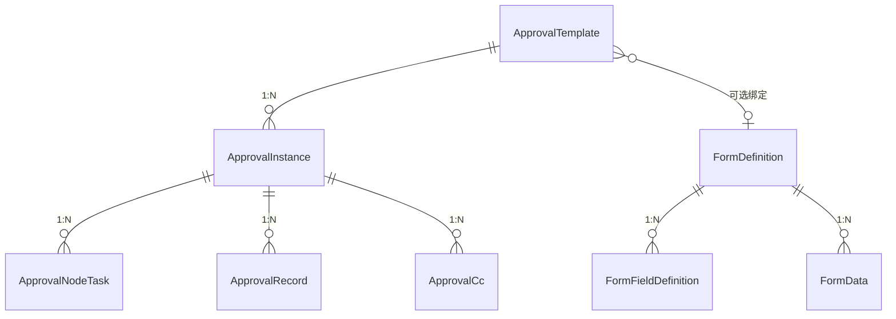
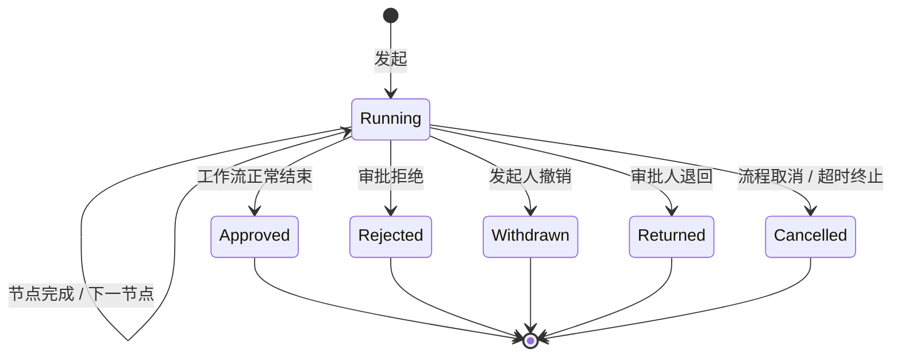

# 审批流系统设计说明

> 适用版本：`labp` 10.7.x（Elsa 3.9 / ABP 10.7 / .NET 10）
>
> 后端位置：`aspnet-core/modules/elsa/LINGYUN.Abp.ElsaNext.ApprovalFlow.*`
>
> 前端位置：`apps/vben5/packages/@abp/approval-flow`
>
> 管理端页面：`apps/vben5/apps/app-antd/src/views/approval-flow`

## 1. 文档目标

本文描述审批流系统的完整设计，包括：

- 系统边界与模块职责；
- 领域模型、数据库表及状态机；
- AntFlow 设计模型到 Elsa 工作流的编译过程；
- 发起、审批、退回、转办、加签、撤销、抄送、超时等运行时流程；
- 待办、已办、我的发起、抄送我的查询与分页；
- 审批时间、办理时长与操作人记录；
- HTTP API、权限、菜单、前端组件；
- 数据库迁移、部署与扩展点。

配套图：

- [实例生命周期](lifecycle.svg)
- [审批时序](sequence.svg)

## 2. 设计原则

| 原则 | 说明 |
| --- | --- |
| Elsa 驱动流程 | 节点流转、条件分支、并行、超时由 Elsa Workflow Runtime 执行 |
| UserTasks 驱动待办 | 审批任务统一使用 Elsa UserTask，不重复建设任务表 |
| ABP 管理业务 | 模板、实例、节点任务索引、审批记录、抄送、表单、部门责任人由 ABP 管理 |
| 设计模型可编译 | AntFlow JSON 通过 `IWorkflowTemplateCompiler` 编译为 Elsa 定义 |
| 模板与实例分离 | 模板保存设计快照；实例保存业务快照，不反向依赖模板当前状态 |
| 记录只追加 | 审批记录不可修改，用于时间线和审计 |
| 多租户 | 聚合根实现 `IMultiTenant`，任务使用工作流租户 |
| 幂等 | 审批决策使用 `UserTask.Revision` + `OperationId` 控制重复提交 |
| 本地化 | 动作、状态、查询范围使用 ABP 本地化资源 |

## 3. 总体架构

### 3.1 模块划分

```mermaid
graph TD
    subgraph 前端
        UI[app-antd 页面]
        PKG[@abp/approval-flow 组件与 API]
    end

    subgraph 后端
        API[ApprovalFlow.HttpApi]
        APP[ApprovalFlow.Application]
        CON[ApprovalFlow.Application.Contracts]
        DOM[ApprovalFlow.Domain]
        ID[ApprovalFlow.Domain.Identity]
        ANT[ApprovalFlow.Domain.AntFlowDesign]
        ACT[ApprovalFlow.Activities]
        EFC[ApprovalFlow.EntityFrameworkCore]
        SHR[ApprovalFlow.Domain.Shared]
    end

    subgraph Elsa
        WF[Elsa Workflow Runtime]
        UT[Elsa UserTasks]
    end

    DB[(PostgreSQL)]
    IDP[(ABP Identity)]

    UI --> PKG --> API
    API --> APP --> DOM
    APP --> CON
    DOM --> ACT
    DOM --> UT
    DOM --> WF
    DOM --> ANT
    ID --> DOM
    ID --> IDP
    DOM --> EFC --> DB
    SHR --> DOM
    SHR --> APP
```

### 3.2 后端项目职责

| 项目 | 职责 |
| --- | --- |
| `LINGYUN.Abp.ElsaNext.ApprovalFlow.Activities` | `ApprovalTask`、`ApprovalCc` 活动；签核模式、审批人规则、动作定义、任务标签 |
| `LINGYUN.Abp.ElsaNext.ApprovalFlow.Domain.Shared` | 状态、枚举、错误码、常量、本地化资源 |
| `LINGYUN.Abp.ElsaNext.ApprovalFlow.Domain` | 模板、实例、节点任务、记录、抄送、委派、表单实体、部门责任人；决策/终止/转办/加签处理器；工作流启停；`IWorkflowTemplateCompiler` |
| `LINGYUN.Abp.ElsaNext.ApprovalFlow.Domain.AntFlowDesign` | AntFlow JSON 解析与 `IWorkflowTemplateCompiler` 实现 |
| `LINGYUN.Abp.ElsaNext.ApprovalFlow.Domain.Identity` | 依赖 ABP Identity 的实现：组织层级、用户/部门目录、身份解析、角色/部门审批人规则 |
| `LINGYUN.Abp.ElsaNext.ApprovalFlow.EntityFrameworkCore` | DbContext、仓储、表映射、迁移支持 |
| `LINGYUN.Abp.ElsaNext.ApprovalFlow.Application.Contracts` | 应用服务接口、DTO、分页输入、权限常量 |
| `LINGYUN.Abp.ElsaNext.ApprovalFlow.Application` | 应用服务实现、DTO 映射、审批编排 |
| `LINGYUN.Abp.ElsaNext.ApprovalFlow.HttpApi` | `/api/approval-flow/**` 控制器 |

> `FormDefinitions` 与 `OrganizationUnits` 已合并进 ApprovalFlow，不再维护独立模块。
>
> ApprovalFlow.Domain 不直接依赖 Identity；Identity 相关实现收敛在 ApprovalFlow.Domain.Identity。

### 3.3 运行时依赖

- `AbpElsaNextUserTasksModule`：Elsa UserTasks 持久化与运行时；
- `AbpElsaNextApprovalFlowActivitiesModule`：注册审批活动；
- `AbpElsaNextApprovalFlowEntityFrameworkCoreModule`：审批、表单、部门责任人表；
- `AbpElsaNextApprovalFlowDomainIdentityModule`：替换身份解析、参与者目录、组织审批人规则；
- `AbpElsaNextApprovalFlowHttpApiModule`：审批 API；
- Elsa Workflow Runtime：工作流定义发布、实例启动与恢复。

## 4. 领域模型

### 4.1 数据库表

表前缀默认 `EX_`，Schema 由 `ElsaNextApprovalFlowDbProperties.DbSchema` 配置。

| 表 | 聚合/实体 | 关键字段 | 主要索引 |
| --- | --- | --- | --- |
| `EX_ApprovalTemplates` | `ApprovalTemplate` | Name、DisplayName、Category、IsPublished、IsEnabled、ElsaDefinitionId、FormDefinitionId、FlowDefinitionJson | `(TenantId, Name)` 唯一 |
| `EX_ApprovalInstances` | `ApprovalInstance` | TemplateId/Name、Title、BusinessKey、Initiator*、ElsaWorkflowInstanceId、Status、StartedAt、FinishedAt、Outcome、FormDataJson | `(TenantId, Status)`、`(TenantId, TemplateId)`、`(TenantId, InitiatorId)` |
| `EX_ApprovalNodeTasks` | `ApprovalNodeTask` | InstanceId、NodeInstanceId、NodeId/Name、TaskId、Approver*、SignMode、Status、Origin、FirstViewedAt、CompletedAt | `InstanceId`、`TaskId` 唯一、`NodeInstanceId + Status` |
| `EX_ApprovalRecords` | `ApprovalRecord` | InstanceId、Node*、TaskId、Actor*、ActionKey、Effect、Comment、OccurredAt | `(InstanceId, OccurredAt)` |
| `EX_ApprovalCcs` | `ApprovalCc` | InstanceId/Reference、Title、Recipient*、Sender*、NotifiedAt、IsRead、ReadAt | `InstanceId`、`(TenantId, RecipientId, IsRead)` |
| `EX_ApprovalDelegations` | `ApprovalDelegation` | Delegator*、Delegate*、EffectiveFrom/To、IsEnabled | `(TenantId, DelegatorId)`、`(TenantId, DelegateId)` |
| `EX_FormDefinitions` | `FormDefinition` | Name、Code、Version、IsPublished、PublishedTime | `(TenantId, Code, Version)` 唯一 |
| `EX_FormFieldDefinitions` | `FormFieldDefinition` | FormDefinitionId、Key、Label、Type、Permission、Order、IsRequired | `(FormDefinitionId, Key)` 唯一 |
| `EX_FormDatas` | `FormData` | FormDefinitionId、FormCode、FormVersion、InstanceId、DataJson | `(FormDefinitionId, InstanceId)` |
| `EX_OrganizationUnitManagerAssignments` | `OrganizationUnitManagerAssignment` | OrganizationUnitId、UserId、IsPrimary、Order | `(TenantId, OrganizationUnitId)`、`(TenantId, UserId)` |

### 4.2 聚合关系



### 4.3 实例状态机



节点任务状态：

```text
Pending ──> Decided
Pending ──> Cancelled
Pending ──> Transferred
```

### 4.4 关键枚举

| 枚举 | 值 |
| --- | --- |
| `ApprovalInstanceStatus` | Running / Approved / Rejected / Withdrawn / Cancelled / Returned |
| `ApprovalNodeTaskStatus` | Pending / Decided / Cancelled / Transferred |
| `ApprovalNodeTaskOrigin` | Workflow / Added |
| `ApprovalSignMode` | Any / All / Sequential |
| `ApprovalOutcome` | Approved / Rejected / Returned / Withdrawn / TimedOut / Cancelled |
| `ApprovalActionEffect` | Approve / Reject / Neutral |
| `ApprovalActionKey` | Approve / Reject / Return / Transfer / AddApproval |
| `ApproverKind` | Participant / Role / OrganizationUnit / Supervisor / Initiator / FormField / InitiatorSelection |
| `UserTaskQueryScopeKind` | Assigned / Available / History / All / NeedsAttention |

## 5. AntFlow 设计模型与编译

### 5.1 设计模型

AntFlow JSON 的核心字段：

- `nodeType`：节点类型；
- `nodeProperty`：节点属性；
- `childNode`：当前节点之后的节点；
- `conditionNodes`：条件分支；
- `parallelNodes`：并行分支。

节点类型：

```text
StartNode
ApprovalNode
CopyNode
ConditionNode
ParallelApproveNode
```

审批节点主要属性：

```text
nodeDisplayName
approverRules
signMode
actions
emptyApproverPolicy
```

### 5.2 编译器契约

Domain 定义：

```csharp
public interface IWorkflowTemplateCompiler
{
    bool CanCompile(JsonElement rootElement);

    Sequence Compile(
        JsonElement rootElement,
        ApprovalTemplate template);
}
```

实现：

```text
AntFlowDesignWorkflowTemplateCompiler
```

职责：

1. 解析 AntFlow JSON；
2. 还原扁平节点树；
3. 将审批节点编译为 `ApprovalTask`；
4. 将抄送节点编译为 `ApprovalCc`；
5. 将条件节点编译为 `If`；
6. 将并行节点编译为并行执行；
7. 通过 Elsa 定义发布接口生成工作流版本。

### 5.3 网关与抄送顺序

AntFlow 网关的 `childNode` 表示分支后的延续节点，常见为抄送节点。

编译器规则：

```text
条件分支
   ↓
网关 childNode（抄送/后续节点）
```

而不是：

```text
网关 childNode
   ↓
条件分支
```

因此抄送节点不会在审批开始前执行。

> 已发布模板需要重新发布后，新的节点顺序才会生效。

### 5.4 发布流程

1. 创建模板草稿；
2. 保存设计 JSON；
3. 发布模板；
4. 编译器生成并发布 Elsa 工作流定义；
5. 绑定可选表单；
6. 模板变为可发起。

发布后修改流程设计必须重新发布，生成新的定义版本。

## 6. 运行时流程

### 6.1 发起审批

```text
POST /api/approval-flow/instances
```

处理顺序：

1. 校验模板可发起；
2. 创建 `ApprovalInstance`，状态 `Running`；
3. 写入发起记录 `ApprovalRecord(Start)`；
4. 生成工作流实例 ID；
5. 启动 Elsa 工作流；
6. 写入工作流输入：

| 输入键 | 内容 |
| --- | --- |
| `ApprovalInstanceId` | 实例 ID |
| `ApprovalInitiator` | 发起人 |
| `ApprovalBusinessKey` | 业务键 |
| `ApprovalFormData` | 表单 JSON |
| `ApprovalFormReference` | 表单引用 |
| `ApprovalTitle` | 审批标题 |

发起记录的操作人来自 `ICurrentUser`，通过身份解析器统一设置。

### 6.2 审批任务创建

`ApprovalTask` 活动：

1. 解析审批人规则；
2. 解析签核模式；
3. 创建 Elsa UserTask；
4. 写入任务标签：

```text
approval
approval-node:{nodeInstanceId}
approval-sign-mode:{mode}
approval-action-effects:{action=effect}
approval-origin:Workflow
approval-node-id:{nodeId}
approval-node-name:{nodeName}
```

5. 通过 UserTask 事件登记 `ApprovalNodeTask`；
6. 任务出现在“我的待办”。

### 6.3 审批决策

```text
POST /api/approval-flow/instances/{id}/decide
```

请求：

```json
{
  "taskId": "...",
  "actionKey": "Approve",
  "comment": "同意",
  "dataJson": "{...}",
  "operationId": "..."
}
```

服务端：

1. 校验实例未结束；
2. 根据 TaskId 查找 `ApprovalNodeTask`；
3. 校验任务处于打开状态；
4. 读取当前用户可访问的 UserTask；
5. 候选任务先领取；
6. 记录 `CompletedAt`；
7. 提交 `UserTask`，通过 `Revision` 做乐观并发；
8. 写入审批记录；
9. 恢复工作流，进入下一节点或结束实例。

表单绑定任务必须提交 `dataJson`，否则 Elsa 表单校验会返回：

```text
form-invalid
```

### 6.4 拒绝与抄送

拒绝时：

1. 实例状态立即置为 `Rejected`；
2. 完成当前 UserTask；
3. 工作流继续但抄送写入前会再次校验。

`ApprovalCcStore` 在发送抄送前校验：

```text
实例状态不是 Rejected/Cancelled/Withdrawn/Returned
且至少存在一个已处理的审批节点
```

因此拒绝、撤回、退回、取消都不会产生抄送。

### 6.5 撤销

```text
POST /api/approval-flow/instances/{id}/withdraw
```

仅发起人可执行；执行后：

- 实例状态变为 `Withdrawn`；
- 未完成节点任务取消；
- 写入撤销记录。

前端“我发起的”页面在 `Running` 状态显示“撤销”。

### 6.6 退回、转办、加签

| 操作 | 接口 | 说明 |
| --- | --- | --- |
| 退回 | `POST /instances/{id}/return` | 结束当前实例为 `Returned` |
| 转办 | `POST /instances/{id}/transfer` | 将当前任务转给其他用户 |
| 加签 | `POST /instances/{id}/add-approval` | 增加审批节点并处理当前任务 |
| 撤签 | 通过加签节点数据 | 移除加签节点 |

所有操作都会写入 `ApprovalRecord`，并携带操作人、节点、任务、意见。

## 7. 时间与办理时长

### 7.1 首次查看时间

```text
POST /api/approval-flow/tasks/{taskId}/view
```

审批人打开待办详情时调用：

```csharp
nodeTask.MarkFirstViewed(now);
```

只在第一次写入：

```csharp
FirstViewedAt ??= at;
```

### 7.2 办理时间

审批动作执行时写入：

```csharp
nodeTask.MarkDecided(now);
```

同时审批记录使用同一个操作时间。

### 7.3 办理时长

前端根据：

```text
CompletedAt - FirstViewedAt
```

自动计算并格式化为：

```text
1天2时3分4秒
2时3分
3分
59秒
0秒
```

为 0 的单位不显示。

审批记录表格、执行记录时间线、已办列表都展示首次查看时间、办理时间和办理时长。

### 7.4 操作人

所有流程动作通过：

```text
IApprovalActorAccessor
   ↓
IUserTaskIdentityResolver
   ↓
AbpUserTaskIdentityResolver
```

解析当前用户。

审批记录的操作人：

```text
record.ActorDisplayName ?? "系统"
```

系统动作（流程结束、超时提醒）显示“系统”。

## 8. 待办、已办、我发起、抄送

### 8.1 待办

```text
GET /api/approval-flow/tasks
```

该接口不再接收 `Scope` 或其他分页参数，返回全部待办：

```csharp
public virtual async Task<ListResultDto<TaskDto>> GetPendingTasksAsync()
```

服务端分别读取：

```text
Assigned   已分配给我的任务
Available  我可以领取的候选任务
```

并通过 Elsa UserTask Cursor 循环取完两个范围，按任务 Id 去重后返回：

```csharp
return new ListResultDto<TaskDto>(
    result.OrderByDescending(x => x.CreatedAt).ToList());
```

前端待办列表使用 VXE Grid 的组件分页：

```text
pagerConfig.enabled = true
pagerConfig.pageSize = 20
```

数据只在页面加载/刷新时请求一次，翻页由 `proxyConfig.ajax.query` 对本地全量数组切片完成。

### 8.2 我发起的

```text
GET /api/approval-flow/instances?onlyMine=true
```

只返回当前用户发起的实例。

### 8.3 已办

```text
GET /api/approval-flow/tasks/done
```

按审批记录分页，返回：

- 实例标题；
- 节点名称；
- 动作；
- 审批意见；
- 处理人；
- 首次查看时间；
- 办理时间；
- 办理时长（前端计算）。

### 8.4 抄送我的

```text
GET /api/approval-flow/carbon-copies
POST /api/approval-flow/carbon-copies/{id}/read
```

标题使用审批实例标题，不使用抄送对象名称。

## 9. HTTP API

基础路由：

```text
/api/approval-flow
```

### 9.1 模板

| 方法 | 路径 | 说明 |
| --- | --- | --- |
| GET | `/templates` | 分页查询 |
| GET | `/templates/{id}` | 详情 |
| POST | `/templates` | 创建 |
| PUT | `/templates/{id}` | 更新显示信息 |
| DELETE | `/templates/{id}` | 删除 |
| POST | `/templates/{id}/publish` | 发布 |
| PUT | `/templates/{id}/design` | 保存设计 |
| GET | `/available-templates` | 可发起模板 |

> `/available-templates` 使用绝对路由，避免被 `{id}` 路由吞掉。

### 9.2 实例

| 方法 | 路径 | 说明 |
| --- | --- | --- |
| POST | `/instances` | 发起 |
| GET | `/instances` | 我发起的分页列表 |
| GET | `/instances/{id}` | 实例详情 |
| GET | `/instances/{id}/detail` | 审批详情聚合 |
| POST | `/instances/{id}/decide` | 审批决策 |
| POST | `/instances/{id}/return` | 退回 |
| POST | `/instances/{id}/transfer` | 转办 |
| POST | `/instances/{id}/add-approval` | 加签 |
| POST | `/instances/{id}/withdraw` | 撤销 |
| GET | `/instances/{id}/records` | 审批记录 |

### 9.3 任务与抄送

| 方法 | 路径 | 说明 |
| --- | --- | --- |
| GET | `/tasks` | 我的待办 |
| POST | `/tasks/{taskId}/view` | 记录首次查看 |
| GET | `/tasks/done` | 我的已办 |
| GET | `/carbon-copies` | 抄送我的 |
| POST | `/carbon-copies/{id}/read` | 标记已读 |

### 9.4 表单

| 方法 | 路径 | 说明 |
| --- | --- | --- |
| GET | `/form-definitions` | 分页 |
| GET | `/form-definitions/{id}` | 详情 |
| POST | `/form-definitions` | 创建 |
| PUT | `/form-definitions/{id}` | 更新 |
| DELETE | `/form-definitions/{id}` | 删除 |
| POST | `/form-definitions/{id}/publish` | 发布 |
| POST | `/form-definitions/{id}/fields` | 添加字段 |
| PUT | `/form-definitions/{id}/fields/{fieldId}` | 修改字段 |
| DELETE | `/form-definitions/{id}/fields/{fieldId}` | 删除字段 |
| GET | `/form-definitions/{id}/data/{instanceId}` | 读取表单数据 |
| PUT | `/form-definitions/{id}/data/{instanceId}` | 保存表单数据 |

## 10. 权限

```text
ApprovalFlow.Templates
ApprovalFlow.Templates.Create
ApprovalFlow.Templates.Update
ApprovalFlow.Templates.Delete
ApprovalFlow.Templates.Publish

ApprovalFlow.Instances
ApprovalFlow.Instances.Create
ApprovalFlow.Instances.Decide
ApprovalFlow.Instances.Withdraw
ApprovalFlow.Instances.Manage

FormDefinitions.Definitions
FormDefinitions.Definitions.Create
FormDefinitions.Definitions.Update
FormDefinitions.Definitions.Delete
FormDefinitions.Definitions.Publish

FormDefinitions.Data
FormDefinitions.Data.Edit
```

权限常量位置：

```text
ElsaNextApprovalFlowPermissions
```

## 11. 前端设计

### 11.1 包结构

```text
packages/@abp/approval-flow/src
├── api
│   ├── useApprovalFlowApi.ts
│   ├── useApprovalParticipantsApi.ts
│   └── useApprovalTasksApi.ts
├── components
│   ├── antflow
│   ├── designer
│   ├── form-definitions
│   ├── instances
│   └── templates
└── types
```

### 11.2 我的审批页面

我的审批已拆分为四个独立页面和组件：

| 页面 | 组件 | 接口 |
| --- | --- | --- |
| 待办 | `PendingApprovalTable` | `GET /tasks` |
| 我发起的 | `InitiatedApprovalTable` | `GET /instances?onlyMine=true` |
| 已办 | `DoneApprovalTable` | `GET /tasks/done` |
| 抄送我的 | `CarbonCopyApprovalTable` | `GET /carbon-copies` |

菜单：

```text
我的审批
├── 待办
├── 我发起的
├── 已办
└── 抄送我的
```

前端路由：

```text
/approval-flow/my-approvals/pending
/approval-flow/my-approvals/initiated
/approval-flow/my-approvals/done
/approval-flow/my-approvals/carbon-copy
```

父级页面使用 `<RouterView />` 作为布局，避免子页面渲染为父级内容。

### 11.3 管理页面

```text
/approval-flow/templates        审批模板
/approval-flow/form-definitions 表单设计
/approval-flow/designer         流程设计器
```

模板页和表单页也使用 `useVbenVxeGrid`，支持查询、工具栏与分页。
### 11.4 VXE Table

所有列表页面统一使用：

```ts
useVbenVxeGrid
```

具备：

- 表单查询；
- 工具栏；
- 刷新；
- 排序；
- 分页；
- 列配置；
- 缩放。

### 11.5 审批详情

审批详情弹窗包含：

```text
审批
表单
流程图
详情
执行记录
```

“审批”Tab 在打开详情时传入待办任务时显示，右侧为审批操作栏。

审批记录展示：

- 动作；
- 处理人；
- 审批意见；
- 首次查看时间；
- 办理时间；
- 办理时长。

## 12. 本地化

资源位置：

```text
LINGYUN.Abp.ElsaNext.ApprovalFlow.Domain.Shared/Localization/Domain
```

关键键：

```text
ElsaNextApprovalFlow.ApprovalRecordAction:Approve
ElsaNextApprovalFlow.ApprovalRecordAction:Reject
ElsaNextApprovalFlow.ApprovalRecordAction:Return
ElsaNextApprovalFlow.ApprovalRecordAction:Transfer
ElsaNextApprovalFlow.ApprovalRecordAction:AddApproval

```

前端统一使用：

```ts
$t('ElsaNextApprovalFlow.ApprovalRecordAction:Approve')
```

## 13. 数据库迁移

迁移统一放在宿主迁移项目，不在业务模块内：

```text
aspnet-core/migrations/LINGYUN.Abp.MicroService.AllInOne.EntityFrameworkCore.PostgreSql
```

相关迁移：

| 迁移 | 说明 |
| --- | --- |
| `AddApprovalNodeTaskTimestamps` | 为 `EX_ApprovalNodeTasks` 增加 `FirstViewedAt`、`CompletedAt` |
| `MergeOrganizationUnitsIntoApprovalFlow` | 合并部门责任人表 |
| `UnifyApprovalFlowTimestamps` | 统一时间字段为 `timestamptz` |

生成迁移：

```bash
dotnet ef migrations add <Name> \
  --project migrations/LINGYUN.Abp.MicroService.AllInOne.EntityFrameworkCore.PostgreSql \
  --startup-project migrations/LINGYUN.Abp.MicroService.AllInOne.EntityFrameworkCore.PostgreSql \
  --context SingleMigrationsDbContext
```

应用：

```bash
dotnet ef database update \
  --project migrations/LINGYUN.Abp.MicroService.AllInOne.EntityFrameworkCore.PostgreSql \
  --startup-project migrations/LINGYUN.Abp.MicroService.AllInOne.EntityFrameworkCore.PostgreSql \
  --context SingleMigrationsDbContext
```

## 14. 扩展点

| 扩展点 | 用途 |
| --- | --- |
| `IWorkflowTemplateCompiler` | 接入其他流程设计 JSON |
| `IApproverRuleResolver` | 自定义审批人解析 |
| `IUserTaskParticipantDirectory` | 自定义用户/部门目录 |
| `IUserTaskIdentityResolver` | 自定义当前用户 Actor 解析 |
| `IUserTaskFormProvider` | 自定义表单渲染与校验 |
| `IApprovalCcSink` | 自定义抄送落地 |
| `IApprovalActorAccessor` | 自定义当前审批人访问方式 |

## 15. 已知限制

1. Elsa UserTask 的 `Revision` 是任务提交的并发依据；前端必须使用最新任务数据。
2. 绑定表单的审批任务提交时必须带 `dataJson`，否则返回 `form-invalid`。
3. 已发布模板不会自动应用新的编译规则，修改编译器后需要重新发布模板。
4. 历史审批记录不会回填首次查看时间、办理时间。
5. 抄送节点需要重新发布模板后才会按“审批后抄送”的新顺序执行。

## 16. 常见问题

### 16.1 审批提交返回 `NoPendingTask`

检查：

1. `TaskId` 是否仍为打开状态；
2. 当前用户是否为任务审批人或候选人；
3. 任务是否已被其他请求完成；
4. 最新 `Revision` 是否被刷新；
5. 日志中的 `ConflictCode`。

### 16.2 返回 `form-invalid`

说明任务绑定了表单，但提交数据未通过表单校验。

检查：

- `dataJson` 是否传递；
- 必填字段是否完整；
- 字段类型是否与表单定义一致；
- 表单是否已经发布并绑定到模板。

### 16.3 抄送在审批前收到

原因通常是旧模板仍使用“抄送节点在条件分支之前”的定义。

处理：

1. 在设计器中重新保存流程；
2. 重新发布模板；
3. 新发起的实例使用新定义。

### 16.4 审批详情没有审批操作

审批详情只在打开时传入待办任务的情况下显示“审批”Tab。

从“我发起的”或“已办”进入详情时，不显示审批操作。
